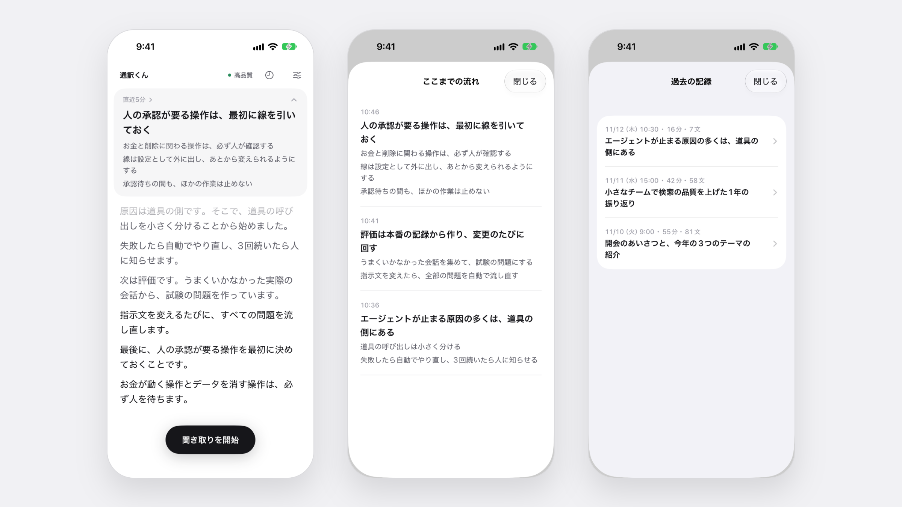

# 通訳くん

英語の講演や会話を iPhone 単体で聞き取り、日本語の字幕と直近5分の要約を出すiOSアプリです。音声認識と即時の翻訳は端末の中で行い、訳し直しと要約には Amazon Bedrock の Claude を使います。端末の外へ送るのは、確定した英文の文字だけです。

Mac 用の会議の文字起こしアプリ「[文字起こしちゃん](https://github.com/minorun365/live-dictation)」の iPhone 版にあたります。

## 動作環境

iOS 26.4 以降の iPhone。訳し直しと要約に Amazon Bedrock の API キーを使います。キーが無いときや回線が切れたときは、端末内の Apple Intelligence で要約します。

## インストール

Xcode から自分の iPhone へ入れて使います。このリポジトリのURLを Claude Code に渡して「iPhone に入れて」と頼むと、下の手順で進めます。

### Claude Code 向けの手順

1. このリポジトリを取得し、`brew install xcodegen` のあと `xcodegen generate` を実行します。
2. `open HandyTranslator.xcodeproj` で開き、Xcode の Settings → Accounts に Apple Account を追加します。
3. ターゲット HandyTranslator の Signing & Capabilities で、Team に自分の名前（Personal Team）を選びます。Bundle Identifier が使えないと表示されたら、project.yml の com.minoruonda を自分のものに変えて `xcodegen generate` をやり直します。
4. iPhone を USB でつなぎ、iPhone 側で「信頼」を押します。設定アプリのプライバシーとセキュリティからデベロッパモードを入にして、再起動します。
5. 実行先に iPhone を選んで Run（⌘R）を押します。初回は iPhone の設定→一般→VPN とデバイス管理で、自分の Apple Account を信頼します。
6. アプリの設定画面を開き、Amazon Bedrock の API キーを貼って保存します。

無料の Apple Account で入れたアプリは、7日で開けなくなります。そのときは手順5をやり直してください。初回は英語の音声認識と翻訳の言語データを取得するので、Wi-Fi につないだ状態で一度「聞き取りを開始」を押しておきます。

## 使い方

「聞き取りを開始」を押すと、画面全体に日本語の字幕が流れ、上に直近5分の要約が出ます。要約は30秒ごとに更新され、5分ごとに「ここまでの流れ」へ積まれていきます。

訳し直しと要約をどこで行うかは、回線とキーの有無で自動で切り替わり、画面右上に表示されます。

| 表示 | 使われる場面 | 字幕と要約 |
|---|---|---|
| 高品質 | Bedrock のキーがあり、回線がつながっている | Claude が文脈を踏まえて字幕を訳し直し、要約を作る |
| 端末内のみ | 回線が無い、またはクラウドを切っている | 字幕は即時訳のまま。要約は Apple Intelligence が作る |
| 即時訳のみ | Apple Intelligence も使えない端末 | 字幕は即時訳のまま。要約は出ない |

停止すると、要約と字幕の記録が iPhone に保存され、時計のボタンから読み返せます。自分の S3 バケットを設定しておくと、停止のたびに記録を自動で送れます。設定の手順は [記録を S3 へ送る](docs/s3.md) にまとめています。

## 開発

Xcode 27 と XcodeGen が必要です。Apple の音声認識と翻訳はシミュレータで動かないため、実機か、同じコードを Mac で動かす検証用のターゲットで試します。音声ファイルを流して試す方法と検証用の環境変数は [開発者向けの情報](docs/development.md) にまとめています。

## ライセンス

ソースコードは [Apache License 2.0](LICENSE) で公開しています。アプリのアイコンは作者本人の写真なので、フォークして配布するときは差し替えてください。
